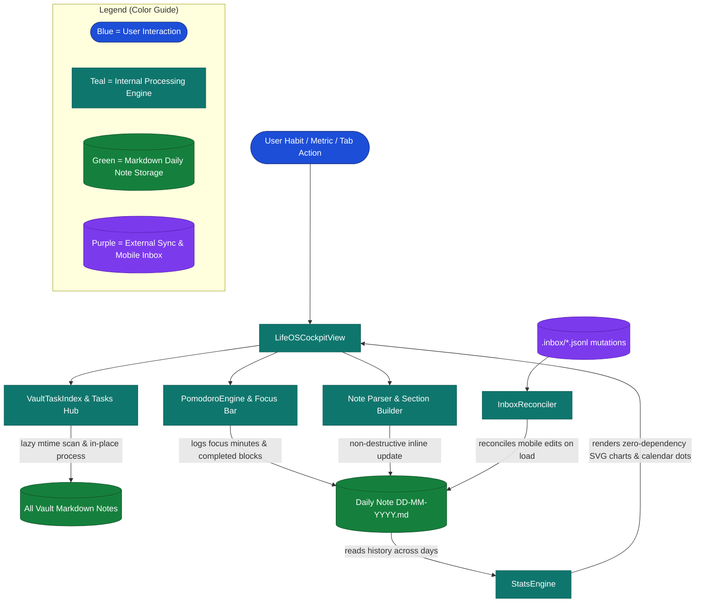
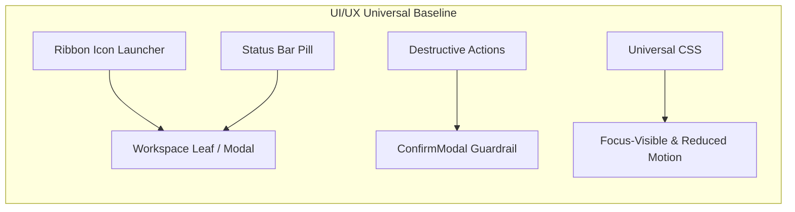
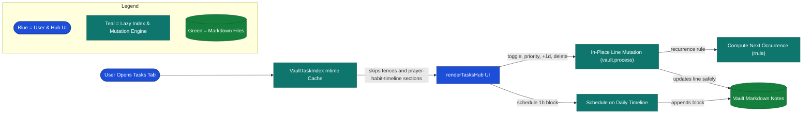
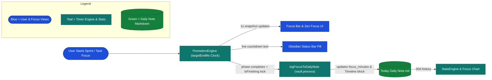

# System Architecture (`ARCHITECTURE.md`)
> **1-Line Summary:** Modular TypeScript full-window cockpit writing transparently to local Markdown daily notes.

## 1. High-Level Visual System Map

## 2. Tech Stack & Why We Chose It

| Layer | Tool / Library | Plain-English Reason Why |
| --- | --- | --- |
| Host / UI | Obsidian Plugin API (`ItemView`) | Full-window tabbed cockpit with left-ribbon shortcut and pinned-tab close protection. |
| Prayer Calculation | `adhan` (`^4.4.3`) | Pure offline astronomical prayer calculation without external network calls. |
| Data Store | Plain Markdown Files (`DD-MM-YYYY.md`) | Offline-first, transparent, git-versionable personal notes with inline fields (`[field:: value]`). |
| Visual Charts | `chart.js` (`^4.4.8`) & Native SVG | Tree-shaken Chart.js canvas renderers with hover tooltips and dynamic Obsidian palette detection. |
| Task NLP & Recurrence | `chrono-node` & `rrule` | Natural-language quick date extraction and RFC-standard recurring task regeneration. |
| Offline Analytics | Python CLI (`scripts/life_os_analytics.py`) | Offline pandas/matplotlib monthly health reports reading standard inline markdown fields. |
| Bundler | `esbuild` | Fast modular build compiling TypeScript to `main.js`. |

## 3. Core Subsystems & Engineering Mechanics

### [SUBSYSTEM: Full-Window-Cockpit-View] | Aliases: cockpit tab router, item view manager
> **1-Line Summary:** Thin <14 KB `ItemView` startup shell that lazily loads `lifeos-cockpit.chunk.js` (`LifeOSCockpitController`), holding four tabs: Cockpit, Tasks, Schedule & Calendar, and Stats & Tracker.
* **Code Anchors (Grep Targets):**
  * `src/main.ts :: LifeOSCockpitView`
  * `src/views.ts :: LifeOSCockpitController`
  * `src/core/chunk-loader.ts :: loadPluginChunkAsync`
  * `src/main.ts :: LifeOSPlugin.activateCockpitView`

### [SUBSYSTEM: Interactive-ChartJS-Renderer] | Aliases: chartjs canvas, stats renderer
> **1-Line Summary:** Lazy `lifeos-charts.chunk.js` bundle using tree-shaken named `chart.js` ESM imports (`BarController` + `LineController` only) with tooltips, dark/light theme switching, and lifecycle memory destruction.
* **Code Anchors (Grep Targets):**
  * `src/chunks/charts.ts :: renderInteractiveChart`
  * `src/core/chartjs-renderer.ts :: renderInteractiveChart`
  * `src/views.ts :: LifeOSCockpitController.destroyActiveCharts`

### [SUBSYSTEM: Task-NLP-And-Recurrence] | Aliases: natural language dates, recurring rules
> **1-Line Summary:** Pure-TS fast paths for common recurring intervals (`daily`/`weekday`/`weekly`/`monthly`) with on-demand `lifeos-nlp.chunk.js` loading for `chrono-node` and complex `rrule` parsing.
* **Code Anchors (Grep Targets):**
  * `src/core/task-nlp.ts :: parseNaturalLanguageTask`
  * `src/core/task-nlp.ts :: computeNextRecurringDate`
  * `src/chunks/nlp.ts :: parseChronoFirstDate`

### [SUBSYSTEM: Note-Parser-And-Section-Builder] | Aliases: note parser, inline field extractor
> **1-Line Summary:** Surgical regex and block parser extracting and updating sleep, water, prayers, habits, tasks, and timeblocks.
* **Code Anchors (Grep Targets):**
  * `src/core/note-parser.ts` -> `parseDailyNote`
  * `src/core/note-parser.ts` -> `applyParsedNoteToMarkdown`

### [SUBSYSTEM: Builtin-Stats-Engine] | Aliases: stats calculator, svg chart generator
> **1-Line Summary:** Computes 30-day aggregate stats and SVG chart elements for vitals and habit consistency.
* **Code Anchors (Grep Targets):**
  * `src/core/stats-engine.ts` -> `computeAggregateStats`
  * `src/core/stats-engine.ts` -> `renderMetricBarChart`

### [SUBSYSTEM: Mobile-Inbox-Reconciler] | Aliases: jsonl reconciler, companion export
> **1-Line Summary:** Ingests external offline `.inbox/*.jsonl` mutations upon workspace layout ready and exports to Super Productivity & Loop Habits.
* **Code Anchors (Grep Targets):**
  * `src/interop/inbox-reconciler.ts` -> `reconcileMobileInbox`

### [SUBSYSTEM: Offline-Python-Analytics-Engine] | Aliases: python analytics, monthly csv export
> **1-Line Summary:** Standalone Python script computing 7-day rolling averages and exporting monthly-summary.csv and monthly-trends.png.
* **Code Anchors (Grep Targets):**
  * `scripts/life_os_analytics.py` -> `main`
  * `src/main.ts` -> `runPythonAnalytics`

### [SUBSYSTEM: Schedule-And-Timeline-Planner] | Aliases: day timeline, week grid, overlap layout, drag and drop
> **1-Line Summary:** Pure-TS visual time-blocking Day Timeline (interval-graph overlap layout, 15-min pointer drag/resize, prayer window markers, unscheduled task drag-and-drop) and 7-day cross-day Week Grid reading existing notes lazily without creating empty files on browse.
* **Code Anchors (Grep Targets):**
  * `src/core/timeline-layout.ts` -> `computeOverlapLayout`, `getWeekDates`
  * `src/ui/schedule-planner.ts` -> `renderScheduleView`
  * `src/views.ts` -> `LifeOSCockpitView.readNoteIfExists`, `LifeOSCockpitView.saveNoteForDate`

### [SUBSYSTEM: UI-UX-Parity-And-Accessibility] | Aliases: status bar, ribbon icon, confirm modal, focus-visible, reduced-motion
> **1-Line Summary:** Integrates native Obsidian workspace UI touchpoints (ribbon launcher, live status bar pill, modal confirmation guardrails) and WCAG AA accessibility styles.
* **Architecture / Subsystem Role:** Standardizes the plugin surface across desktop and mobile Obsidian clients with keyboard accessibility, reduced-motion safety, and high-visibility status telemetry.
* **Component Diagram:**

* **Code Anchors (Grep Targets):** `src/main.ts`, `styles.css`

### [SUBSYSTEM: Lazy-Vault-Task-Index-And-Hub] | Aliases: vault task index, tasks hub, mtime cache, smart buckets
> **1-Line Summary:** On-demand `mtime`-cached Markdown task scanner and interactive Tasks Hub mutating vault task lines safely in place without adding startup cost.
* **How It Works (Plain English):** Nothing scans vault tasks when Obsidian starts. Opening the `Tasks` tab instantiates `VaultTaskIndex`, reads only modified Markdown files (skipping fenced code blocks and daily-note `## Prayers` / `## Habits` / `## Timeline` sections), and renders `renderTasksHub` with live buckets, tag pills, and instant in-place edits (`app.vault.process`) plus recurring next-instance creation and 1-click scheduling onto today's timeline.
* **Component Diagram:**

* **Code Anchors (Grep Targets):**
  * `src/core/note-parser.ts` -> `parseTaskLine`, `serializeTaskLine`
  * `src/core/vault-task-index.ts` -> `VaultTaskIndex`, `toggleVaultTask`, `cycleVaultTaskPriority`, `postponeVaultTask`
  * `src/ui/tasks-hub.ts` -> `renderTasksHub`
  * `src/views.ts` -> `LifeOSCockpitView.renderTasksTab`

### [SUBSYSTEM: Pomodoro-And-Focus-Time-Tracker] | Aliases: pomodoro engine, zen focus, focus bar, status bar timer
> **1-Line Summary:** Plugin-hosted wall-clock Pomodoro state machine driving the Focus Bar, Zen Focus mode, Obsidian status bar countdown, and daily focus logging with zero idle background timers.
* **How It Works (Plain English):** `ensurePomodoroEngine()` creates the `PomodoroEngine` lazily on first interaction or view mount, with zero timers started until the user begins a sprint. Ticks use wall-clock `targetEndMs` timestamps and push snapshot updates in place to both the Obsidian status bar pill (`main.ts`) and whichever Focus UI (`renderCompactFocusBar` or `renderZenFocusView`) is currently mounted, logging completed sessions cleanly via `app.vault.process` into `[focus_minutes::]`, `[focus_sessions::]`, optional `## Timeline` blocks, and Stats charts.
* **Component Diagram:**

* **Code Anchors (Grep Targets):**
  * `src/core/pomodoro-engine.ts` -> `PomodoroEngine`, `logFocusToDailyNote`
  * `src/ui/pomodoro-bar.ts` -> `renderCompactFocusBar`, `renderZenFocusView`
  * `src/main.ts` -> `LifeOSPlugin.ensurePomodoroEngine`
  * `src/views.ts` -> `LifeOSCockpitView.toggleZenFocusMode`, `LifeOSCockpitView.renderStatsTab`
