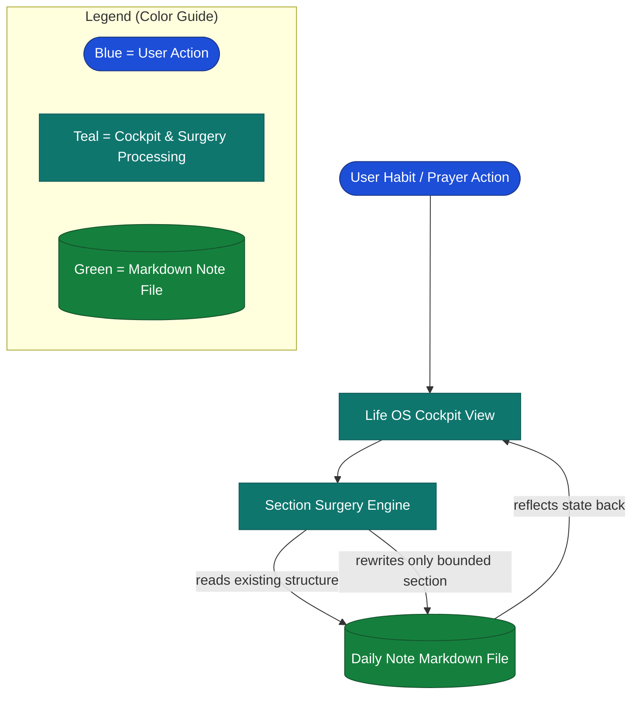

# System Architecture (`ARCHITECTURE.md`)
> **1-Line Summary:** Modular TypeScript cockpit writing transparently to local Markdown files.

## 1. High-Level Visual System Map

## 2. Tech Stack & Why We Chose It

| Layer | Tool / Library | Plain-English Reason Why |
| --- | --- | --- |
| Host / UI | Obsidian Plugin API | Seamless embedding in workspace sidebars and main panels. |
| Data Store | Plain Markdown Files | Offline-first, transparent, git-versionable personal notes. |
| Bundler | esbuild | Fast modular build into `runtime/main.js`. |

## 3. Core Subsystems & Engineering Tricks

### [SUBSYSTEM: Markdown-Section-Surgeon] | Aliases: regex section updater, note parser
> **1-Line Summary:** Replaces only exact markdown heading boundaries to prevent user note corruption.
* **Code Anchors (Grep Targets):**
  * `src/main.ts` -> `replaceNoteSection`

## 4. Recipes: How to Add New Things Safely
* **To add a new daily metric stepper:**
  1. Add metric definition in `src/types.ts` -> `DailyMetricKey`.
  2. Register UI stepper in `src/views.ts` -> `renderMetricSteppers`.
