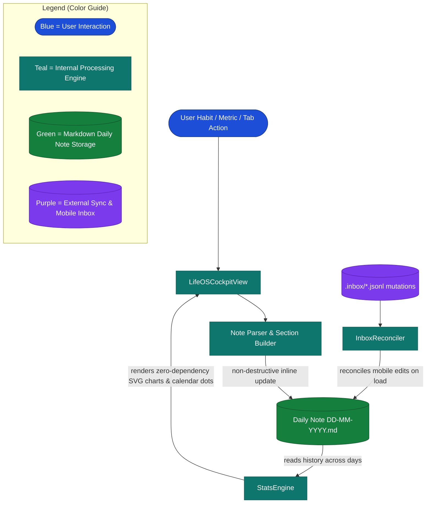
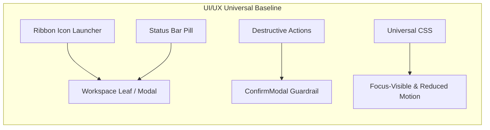

# System Architecture (`ARCHITECTURE.md`)
> **1-Line Summary:** Modular TypeScript full-window cockpit writing transparently to local Markdown daily notes.

## 1. High-Level Visual System Map

## 2. Tech Stack & Why We Chose It

| Layer | Tool / Library | Plain-English Reason Why |
| --- | --- | --- |
| Host / UI | Obsidian Plugin API (`ItemView`) | Full-window tabbed cockpit with left-ribbon shortcut and pinned-tab close protection. |
| Prayer Calculation | `adhan` (`^4.4.3`) | Pure offline astronomical prayer calculation without external network calls. |
| Data Store | Plain Markdown Files (`DD-MM-YYYY.md`) | Offline-first, transparent, git-versionable personal notes with inline fields (`[field:: value]`). |
| Visual Charts | `chart.js` (`^4.4.8`) & Native SVG | Tree-shaken Chart.js canvas renderers with hover tooltips and dynamic Obsidian palette detection. |
| Task NLP & Recurrence | `chrono-node` & `rrule` | Natural-language quick date extraction and RFC-standard recurring task regeneration. |
| Offline Analytics | Python CLI (`scripts/life_os_analytics.py`) | Offline pandas/matplotlib monthly health reports reading standard inline markdown fields. |
| Bundler | `esbuild` | Fast modular build compiling TypeScript to `main.js`. |

## 3. Core Subsystems & Engineering Mechanics

### [SUBSYSTEM: Full-Window-Cockpit-View] | Aliases: cockpit tab router, item view manager
> **1-Line Summary:** Full-window view holding five tabs: Daily Cockpit, Calendar View, Stats & Tracker, Tasks & Timeblocks, and Settings.
* **Code Anchors (Grep Targets):**
  * `src/views.ts` -> `LifeOSCockpitView`
  * `src/main.ts` -> `activateCockpitView`

### [SUBSYSTEM: Interactive-ChartJS-Renderer] | Aliases: chartjs canvas, stats renderer
> **1-Line Summary:** Mounts interactive Chart.js canvases with tooltips, dark/light theme switching, and lifecycle memory destruction.
* **Code Anchors (Grep Targets):**
  * `src/core/chartjs-renderer.ts` -> `renderInteractiveChart`
  * `src/views.ts` -> `destroyActiveCharts`

### [SUBSYSTEM: Task-NLP-And-Recurrence] | Aliases: natural language dates, recurring rules
> **1-Line Summary:** Parses human date phrases from task titles and schedules next recurrence on completion.
* **Code Anchors (Grep Targets):**
  * `src/core/task-nlp.ts` -> `parseNaturalLanguageTask`
  * `src/core/task-nlp.ts` -> `computeNextRecurringDate`

### [SUBSYSTEM: Note-Parser-And-Section-Builder] | Aliases: note parser, inline field extractor
> **1-Line Summary:** Surgical regex and block parser extracting and updating sleep, water, prayers, habits, tasks, and timeblocks.
* **Code Anchors (Grep Targets):**
  * `src/core/note-parser.ts` -> `parseDailyNote`
  * `src/core/note-parser.ts` -> `applyParsedNoteToMarkdown`

### [SUBSYSTEM: Builtin-Stats-Engine] | Aliases: stats calculator, svg chart generator
> **1-Line Summary:** Computes 30-day aggregate stats and SVG chart elements for vitals and habit consistency.
* **Code Anchors (Grep Targets):**
  * `src/core/stats-engine.ts` -> `computeAggregateStats`
  * `src/core/stats-engine.ts` -> `renderMetricBarChart`

### [SUBSYSTEM: Mobile-Inbox-Reconciler] | Aliases: jsonl reconciler, companion export
> **1-Line Summary:** Ingests external offline `.inbox/*.jsonl` mutations upon workspace layout ready and exports to Super Productivity & Loop Habits.
* **Code Anchors (Grep Targets):**
  * `src/interop/inbox-reconciler.ts` -> `reconcileMobileInbox`

### [SUBSYSTEM: Offline-Python-Analytics-Engine] | Aliases: python analytics, monthly csv export
> **1-Line Summary:** Standalone Python script computing 7-day rolling averages and exporting monthly-summary.csv and monthly-trends.png.
* **Code Anchors (Grep Targets):**
  * `scripts/life_os_analytics.py` -> `main`
  * `src/main.ts` -> `runPythonAnalytics`

### [SUBSYSTEM: UI-UX-Parity-And-Accessibility] | Aliases: status bar, ribbon icon, confirm modal, focus-visible, reduced-motion
> **1-Line Summary:** Integrates native Obsidian workspace UI touchpoints (ribbon launcher, live status bar pill, modal confirmation guardrails) and WCAG AA accessibility styles.
* **Architecture / Subsystem Role:** Standardizes the plugin surface across desktop and mobile Obsidian clients with keyboard accessibility, reduced-motion safety, and high-visibility status telemetry.
* **Component Diagram:**

* **Code Anchors (Grep Targets):** `src/main.ts`, `styles.css`
