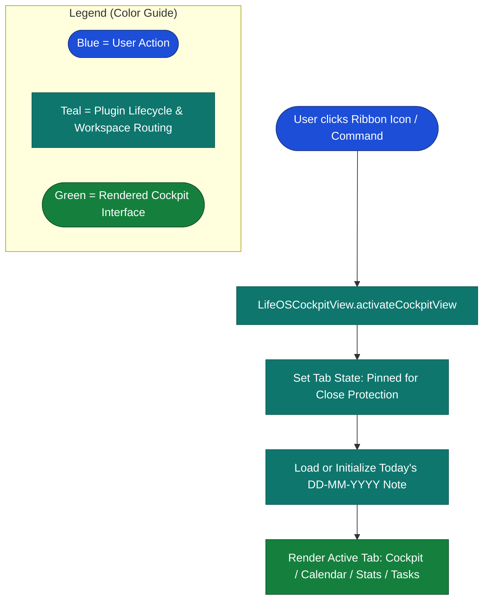
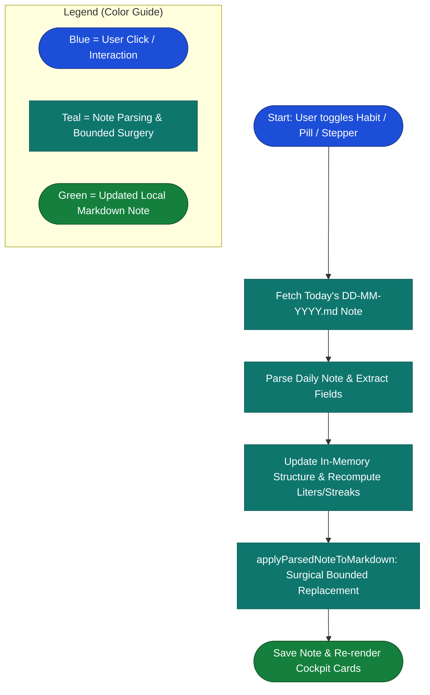
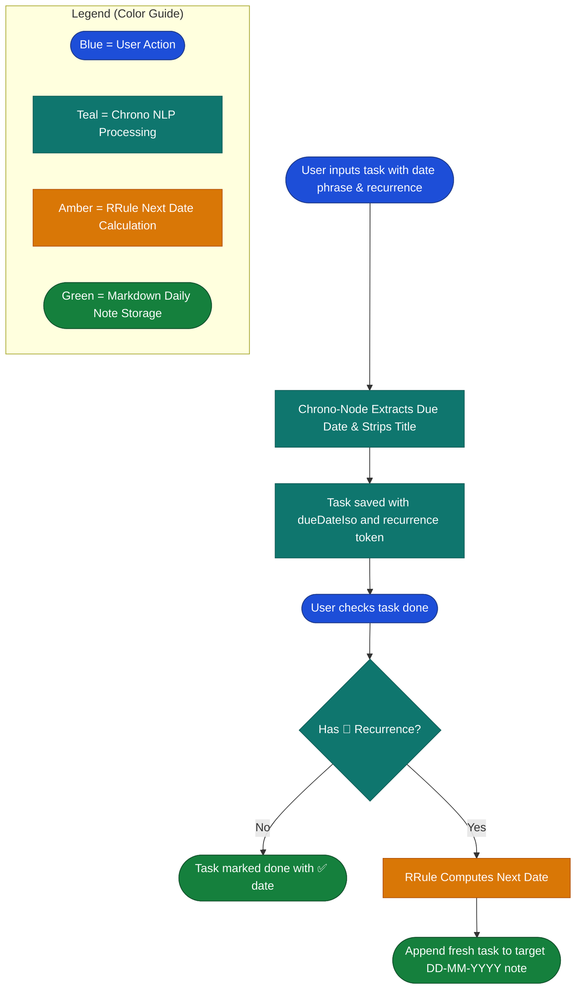
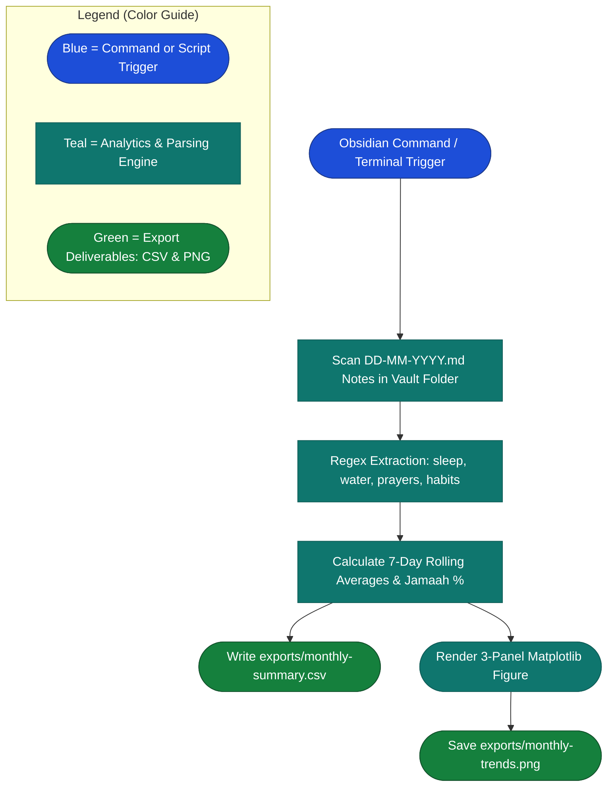

# Visual Feature & Change Log (`VISUAL_LOG.md`)
> **1-Line Summary:** Flowcharts explaining Life OS daily tracking, stats engine, and cockpit lifecycle.

## Feature & Change Flowcharts

### [VISUAL: Full-Window-Cockpit-Tab-Lifecycle] | Aliases: cockpit tab flow, item view open
> **1-Line Summary:** User clicks ribbon icon or runs command; workspace activates full-window pinned tab and populates current daily note.

### [VISUAL: Non-Destructive-Note-Parsing-Cycle] | Aliases: habit toggle flow, section update flow
> **1-Line Summary:** User modifies metric or habit; parser preserves existing note text and applies surgical section rewrite.

### [VISUAL: Task-NLP-And-Recurrence-Lifecycle] | Aliases: task chrono parse, rrule reschedule
> **1-Line Summary:** Chrono-node extracts natural language dates during task entry; on completion, RRule calculates and schedules the next date.

### [VISUAL: Offline-Python-Analytics-Pipeline] | Aliases: python analytics pipeline, monthly report flow
> **1-Line Summary:** Python script parses inline fields across daily notes to produce rolling averages, CSV summary, and PNG trend plots.

