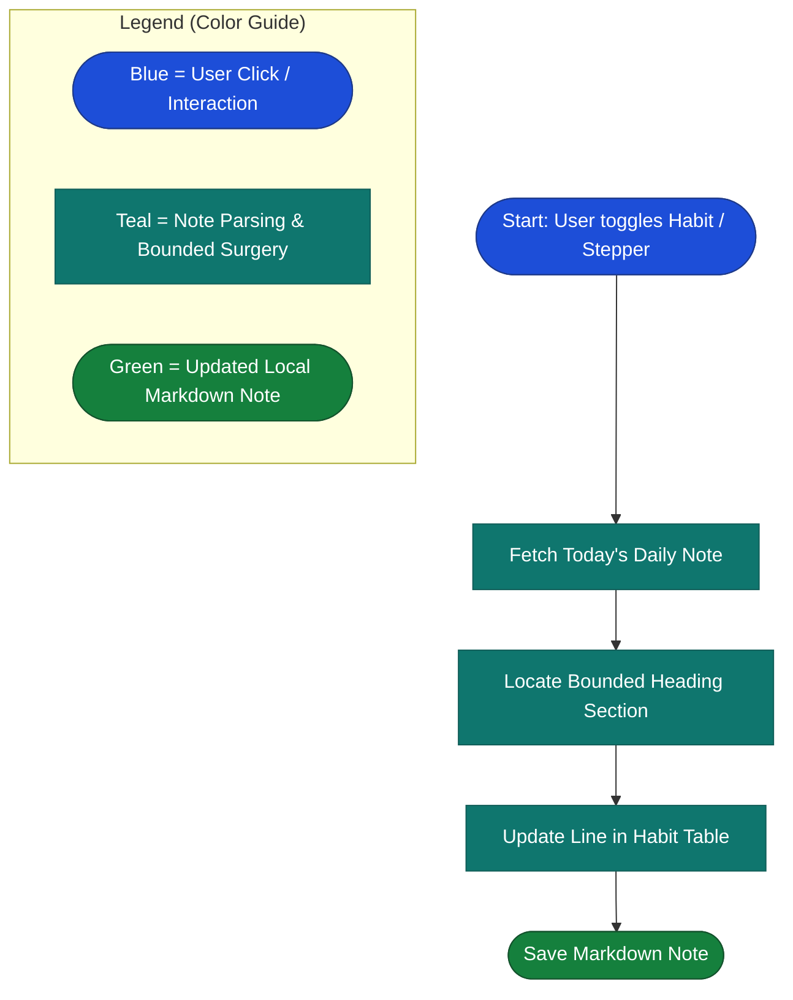

# Visual Feature & Change Log (`VISUAL_LOG.md`)
> **1-Line Summary:** Flowcharts explaining Life OS daily tracking and note surgery.

## Feature & Change Flowcharts

### [VISUAL: Daily-Cockpit-Update-Cycle] | Aliases: habit toggle flow, section update flow
> **1-Line Summary:** User clicks habit in cockpit; plugin performs surgical section update in today's daily note.

